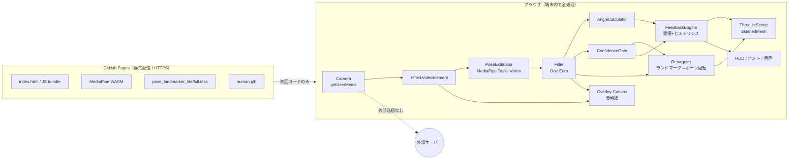
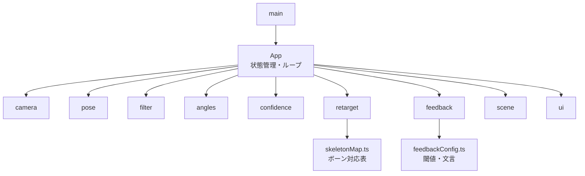
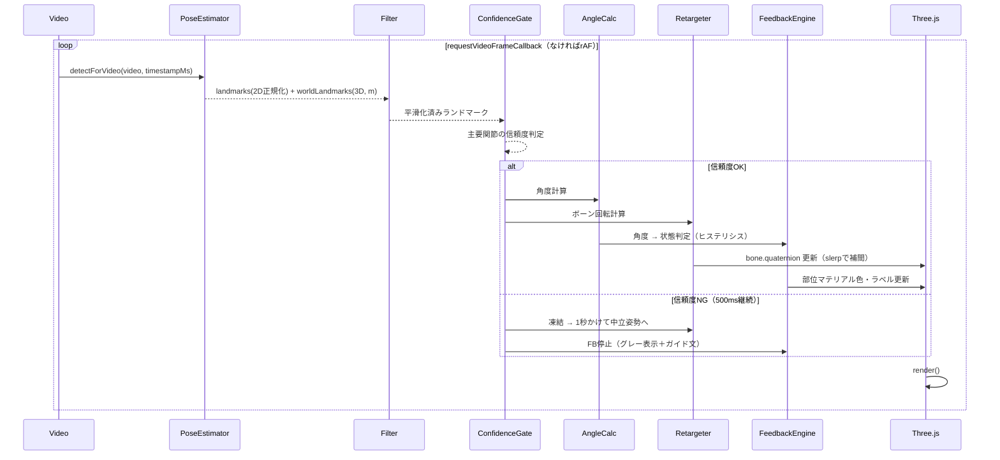
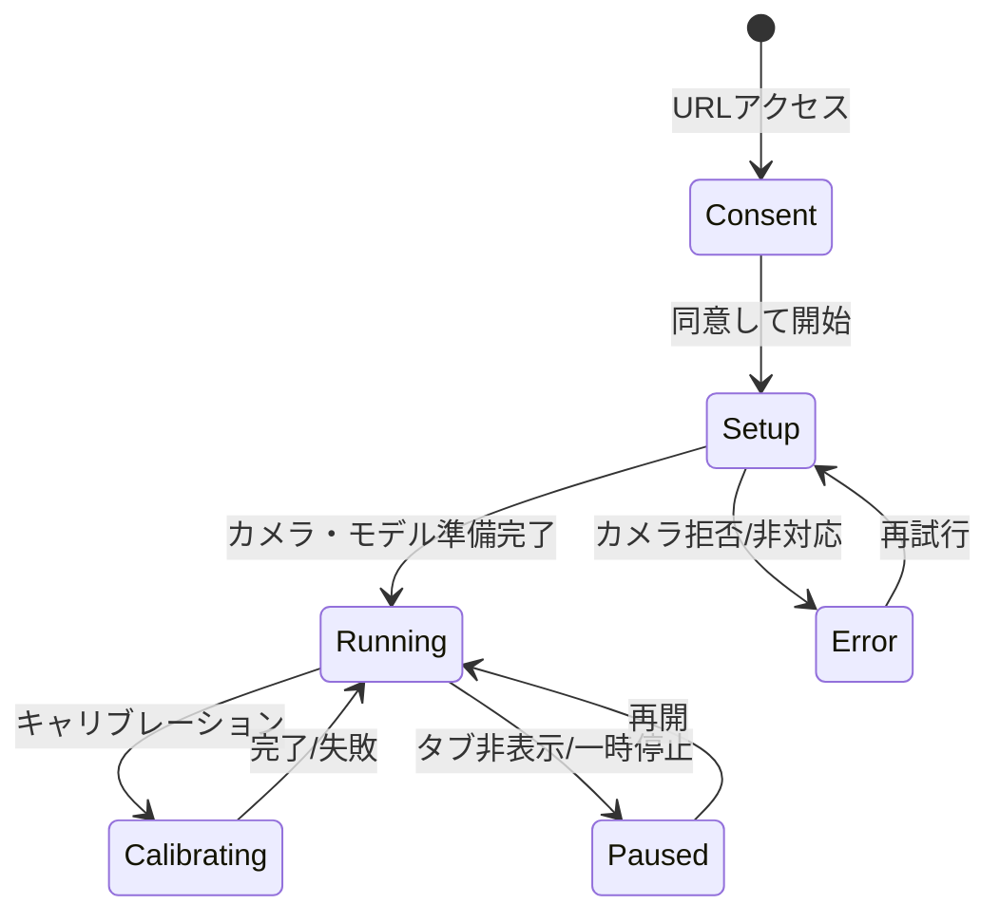

# AI 3D Posture Coach 要件定義書

| 項目 | 内容 |
|---|---|
| 文書版数 | v1.0（Codex実装着手用） |
| 作成日 | 2026-10-10 |
| 対象 | MVP（産業保健・健康経営セミナー向け体験型デモ） |
| 位置づけ | 姿勢教育用デモ。医療機器・診断システムではない |

---

## 0. この文書の読み方

### 0.1 実現性ラベル

本書では各機能・仕様に以下のラベルを付ける。Codexはラベルに従って優先度と「検証で止める判断」を行うこと。

| ラベル | 意味 | 扱い |
|---|---|---|
| **[確定]** | 既存技術で実現可能。実装方法が確立している | そのまま実装 |
| **[要検証]** | 原理的に可能だが、精度・速度・見た目が実機で確認できていない | 検証タスクを先に実施し、基準未達なら代替案に切り替え |
| **[MVP外]** | 実装しない、または実装すべきでない | 実装しない。設計上の拡張余地のみ残す |

### 0.2 前提とした仮定（不明事項）

| # | 仮定 | 影響 | 違った場合 |
|---|---|---|---|
| A1 | デモの主機材は **PC + 外付けWebカメラ + プロジェクター**。スマホは参加者が手元で試す副次用途 | 性能目標・レイアウト優先度 | スマホ主体なら軽量モデル固定・FPS目標を下げる |
| A2 | 対象端末は iPhone 12以降 / iOS 17以降のSafari、Android Chrome最新版（2021年以降の中位機以上）、PC Chrome/Edge/Safari最新版 | 性能要件 | 旧端末は「推奨外」表示 |
| A3 | 撮影は **被験者の側面（矢状面）** を基本とする。正面撮影は参考値扱い | 角度精度の根幹 | 正面必須なら体幹前屈角度の精度は大きく低下（6章参照） |
| A4 | 被験者は1名、全身（頭〜足首）がフレーム内、距離2.5〜3.5m | 推定精度 | 上半身のみなら下肢連動は無効化 |
| A5 | 会場Wi-Fiは不安定と想定。初回ロード後はオフラインで動作することが望ましい | アセット配置 | 安定回線があればCDN利用可 |
| A6 | 3D人体モデルは自作（Blender）またはライセンスが明確な素材を使用。初期はThree.jsのプリミティブ製マネキンで代替 | 開発順序 | 完成モデルが既にあればPhase 3を前倒し |
| A7 | 表示言語は日本語のみ | UI文言 | 多言語化はMVP外 |

---

## 1. プロジェクト概要と目的

### 1.1 概要
スマートフォン／PCのカメラ映像からブラウザ内で人物の骨格を推定し、画面右側の3D人体モデルに動作をリアルタイムに反映する静的Webアプリ。3Dモデル上で体幹前傾などの姿勢変化を色・数値・短文ヒントで可視化する。

### 1.2 目的
- セミナー参加者に「AIで身体の動きがここまで可視化できる」という驚きと気づきを提供する
- 持ち上げ動作などで「腰から曲げる」「膝を使う」の違いを、自分の身体を使って体感させる

### 1.3 スコープ上の明確な線引き
- 表示する角度・色は **姿勢変化を分かりやすく示す演出** であり、医学的安全性・腰痛リスクを判定しない
- 画面上に常時「本アプリは姿勢教育用のデモであり、診断・評価を行うものではありません」と表示する

---

## 2. 想定利用シーン

| シーン | 機材 | 流れ | 所要 |
|---|---|---|---|
| S1: 講師デモ（主） | PC + Webカメラ + プロジェクター | 講師または参加者1名が前に出て、側面から撮影。前屈→スクワット→持ち上げ模擬を実演し、会場全体がスクリーンで3Dモデルの色変化を見る | 3〜5分 |
| S2: 参加者体験 | 参加者自身のスマホ（QRコードでURL配布） | 2人1組で、1人が撮影・1人が動作。スマホ縦画面で上下分割表示 | 1〜2分/人 |
| S3: 休憩時間の展示 | タブレット/PCを三脚固定 | 来場者が自由に試す。操作は「開始」ボタンのみ | 随時 |

---

## 3. ユーザーストーリー

| ID | ユーザー | ストーリー | 受け入れ観点 |
|---|---|---|---|
| US-01 | 講師 | URLを開いてボタン1つでカメラと3Dモデルを起動したい。セミナー中に設定で迷いたくない | 起動まで2タップ以内（同意→開始） |
| US-02 | 参加者 | 自分が前かがみになると3Dモデルも同じように前かがみになるのを見たい | 体幹前屈が遅延少なくモデルに反映 |
| US-03 | 参加者 | 深く前かがみになると3Dモデルの腰周りの色が変わり、何に気をつければよいか短い文で知りたい | 色変化＋ヒント文表示 |
| US-04 | 参加者 | 膝を曲げて体を起こすと色が戻り、「良くなった」ことが分かりたい | 姿勢改善で色が戻る（ちらつきなし） |
| US-05 | 講師 | 人がフレームから外れたとき、モデルが暴れずに「全身を映してください」と表示されてほしい | 低信頼時は凍結＋ガイド表示 |
| US-06 | 参加者 | カメラ映像がどこにも送信されないことを使う前に確認したい | 同意画面で明示 |
| US-07 | 講師 | 3つの動作モード（前屈／スクワット／持ち上げ）を切り替えて解説したい | モード切替でフィードバック内容が変わる |
| US-08 | 講師 | 被験者の直立姿勢を基準として登録し、そこからの変化量で見せたい | キャリブレーション機能 |

---

## 4. 機能要件一覧

| ID | 機能 | 内容 | 優先度 | ラベル |
|---|---|---|---|---|
| F-01 | 同意・説明画面 | カメラ利用目的、端末内処理、非保存、外部通信先、デモである旨を表示。同意後にカメラ起動 | Must | [確定] |
| F-02 | カメラ起動 | getUserMediaで起動。前面/背面切替、PCは複数カメラ選択 | Must | [確定] |
| F-03 | 姿勢推定 | MediaPipe Pose Landmarker（VIDEOモード、1人）で33点推定 | Must | [確定] |
| F-04 | 骨格オーバーレイ | 左ペインにカメラ映像＋骨格線・関節点をCanvas描画 | Must | [確定] |
| F-05 | 座標平滑化 | One Euro Filterでランドマークを平滑化 | Must | [確定] |
| F-06 | 関節角度計算 | 体幹前傾、股関節屈曲、膝関節屈曲（左右） | Must | [確定]（側面撮影時） |
| F-07 | 信頼度判定 | visibility/presenceから主要関節の信頼度を算出し、低信頼時はモデル凍結・FB停止 | Must | [確定] |
| F-08 | 3Dモデル表示 | Three.jsでGLB（初期はプリミティブマネキン）を描画。OrbitControlsで視点回転 | Must | [確定] |
| F-09 | リターゲティング | ランドマーク→ボーン回転（体幹・骨盤・下肢を優先、上肢は簡易） | Must | [要検証]（見た目の自然さ） |
| F-10 | 接地補正 | 足が床に接するようルート高さを補正（スクワットで沈み込む表現） | Should | [要検証] |
| F-11 | キャリブレーション | 直立3秒静止で基準姿勢を記録し、相対角度を算出 | Must | [確定] |
| F-12 | 部位ハイライト | 体幹・大腿・下腿などの部位マテリアル色を緑/橙/赤に変化 | Must | [確定] |
| F-13 | 角度ラベル | 3Dモデル近傍に体幹前傾角度を表示 | Must | [確定] |
| F-14 | ヒント表示 | 状態に応じた短文（20字以内目安）を表示 | Must | [確定] |
| F-15 | ヒステリシス | 閾値ヒステリシス＋最小持続時間でちらつき防止 | Must | [確定] |
| F-16 | 動作モード切替 | 前屈／スクワット／持ち上げ模擬 | Must | [確定] |
| F-17 | 鏡表示切替 | 前面カメラ時は鏡像表示、モデルも鏡像で動かす。トグル可 | Must | [確定] |
| F-18 | 音声フィードバック | Web Speech APIで状態変化時に短く読み上げ（初期OFF） | Could | [要検証]（iOSの発話制約） |
| F-19 | FPS/状態表示 | デバッグ用にFPS・推論時間・信頼度を表示（URLパラメータ `?debug=1`） | Should | [確定] |
| F-20 | タブ非表示時の停止 | visibilitychangeで推論とカメラを一時停止 | Must | [確定] |
| F-21 | オフライン動作 | WASM・モデルファイルを同一オリジンに同梱。Service Workerでキャッシュ | Should | [確定] |

---

## 5. 非機能要件一覧

| ID | 区分 | 要件 | 目標値 |
|---|---|---|---|
| NF-01 | 性能（PC） | 推論＋描画FPS | 25fps以上（Chrome, 2020年以降のノートPC） |
| NF-02 | 性能（スマホ） | 推論＋描画FPS | 15fps以上（iPhone 12 / 中位Android） [要検証] |
| NF-03 | 遅延 | 動作からモデル反映までの体感遅延 | 200ms以下を目標 [要検証] |
| NF-04 | 連続稼働 | クラッシュ・著しい発熱なく稼働 | iPhoneで10分、PCで60分 |
| NF-05 | 初回ロード | 初回の転送量（gzip） | 15MB以下（10進、15,000,000 bytes）。ASSET-SIZES.mdの選択プリセット別集計で合格 |
| NF-06 | 互換性 | 対応ブラウザ | iOS Safari 17+、Android Chrome最新、PC Chrome/Edge/Safari最新 |
| NF-07 | プライバシー | 映像・ランドマークの外部送信 | 0件（ネットワークタブで検証） |
| NF-08 | セキュリティ | 配信 | HTTPS（GitHub Pages）、CSPメタタグ設定 |
| NF-09 | 保守性 | 言語・構成 | TypeScript strict、モジュール分割、ESLint |
| NF-10 | 運用コスト | ホスティング | GitHub Pages（無料）、外部API不使用 |
| NF-11 | アクセシビリティ | 文字サイズ | 角度表示はスマホで24px以上、プロジェクター表示で48px以上 |
| NF-12 | 可用性 | オフライン | 初回ロード後、機内モードで起動可能（F-21実装時） |

---

## 6. システム構成図

### 6.1 全体構成



### 6.2 モジュール依存



---

## 7. 技術スタックと選定理由

| 領域 | 採用 | 選定理由 | 代替案 | トレードオフ |
|---|---|---|---|---|
| 言語 | TypeScript（strict） | 座標・角度の型ミスを防ぐ。Codexの生成品質も安定 | 素のJS | JSは手軽だが規模拡大時に破綻しやすい |
| ビルド | Vite | 静的出力が簡単、`base`設定でGitHub Pages対応、開発時HTTPS可 | なし（ESM直書き） | 依存管理・バンドル最適化を手作業で行うことになる |
| 姿勢推定 | **MediaPipe Pose Landmarker（@mediapipe/tasks-vision）** | ブラウザ動作実績、33点＋3Dワールド座標、GPU/CPU、無料 | TensorFlow.js MoveNet / BlazePose | MoveNetは高速だが17点・3Dなし。体幹と足部の表現が弱い |
| 3D描画 | Three.js | GLTFLoader・SkinnedMesh・ボーン操作が標準。情報量最大 | Babylon.js | Babylonも同等だが、Codexの生成精度・事例数でThree.jsが有利 |
| 3Dモデル制作 | Blender → GLB | 要件どおり。部位別マテリアル・ボーン命名を自分で制御できる | Mixamo / MakeHuman素材 | 素材は早いがボーン構成・ライセンスの確認が必要 |
| 平滑化 | One Euro Filter（自前実装、約50行） | 低速時に強く平滑、高速時に追従。デモ向きの定番 | 移動平均 / カルマン | 移動平均は遅延大、カルマンは調整コスト大 |
| 状態管理 | 素のTSクラス＋イベント | 画面が1つでありフレームワーク不要 | React等 | 60fpsループとの相性・バンドルサイズでフレームワークは不利 |
| CSS | 素のCSS（CSS変数） | 依存最小。ダークネイビーのテーマ変数化 | Tailwind | 手軽だがビルド設定が増える |
| デプロイ | GitHub Actions → GitHub Pages | 無料、push時自動公開 | 手動で`gh-pages`ブランチ | 手動は事故が起きやすい |
| 音声 | Web Speech API（speechSynthesis） | 追加ライブラリ・通信不要 | 事前録音mp3 | 録音は品質安定するが文言変更のたびに再録音 |

**MediaPipeのモデル選択（推奨：full、スマホはlite）**

| モデル | サイズ目安 | 精度 | 速度 | 用途 |
|---|---|---|---|---|
| lite | 約5〜6MB | 低 | 速 | スマホ既定 |
| full | 約9MB | 中 | 中 | PC既定 |
| heavy | 約30MB | 高 | 遅 | MVP不採用（ロード・発熱） |

ファイルサイズとAPI詳細は実装時点の公式配布物で確認し、バージョンを `package.json` で固定すること。

---

## 8. 姿勢推定から3Dモデル表示までの処理フロー

### 8.1 フレーム処理シーケンス



### 8.2 推論と描画の分離

- 描画（Three.js）は `requestAnimationFrame` で常に回す
- 推論は「前回の推論が完了している場合のみ」実行（スキップ方式）。推論FPSが描画FPSより低くても、ボーン回転は前回目標値へ slerp で補間し滑らかに見せる
- スマホでは推論を最大20fpsに間引く（発熱対策）

### 8.3 カメラ設定 [確定]

```ts
const stream = await navigator.mediaDevices.getUserMedia({
  audio: false,
  video: {
    facingMode: mode,            // 'user' | 'environment'
    width: { ideal: 640 },
    height: { ideal: 480 },
    frameRate: { ideal: 30, max: 30 },
  },
});
video.srcObject = stream;
video.muted = true;
video.playsInline = true;        // iOS必須（属性 playsinline も付与）
await video.play();              // ユーザー操作のハンドラ内で呼ぶ
```

- 解像度は640×480を既定とする。高解像度は推論精度をほぼ上げず、負荷だけ増える
- 縦向きスマホでは実際の解像度が480×640等になるため、`video.videoWidth/Height` を毎回参照する

### 8.4 MediaPipe初期化 [確定]

```ts
import { FilesetResolver, PoseLandmarker } from '@mediapipe/tasks-vision';

const fileset = await FilesetResolver.forVisionTasks(`${import.meta.env.BASE_URL}mediapipe/wasm`);
const landmarker = await PoseLandmarker.createFromOptions(fileset, {
  baseOptions: {
    modelAssetPath: `${import.meta.env.BASE_URL}models/pose_landmarker_${isMobile ? 'lite' : 'full'}.task`,
    delegate: 'GPU',             // 失敗時に 'CPU' で再生成
  },
  runningMode: 'VIDEO',
  numPoses: 1,
  minPoseDetectionConfidence: 0.5,
  minPosePresenceConfidence: 0.5,
  minTrackingConfidence: 0.5,
  outputSegmentationMasks: false,
});
```

- WASMとモデルは `public/` に同梱し同一オリジンから配信（外部通信ゼロ、会場回線に非依存）
- GPUデリゲートは端末・ブラウザで挙動差がある [要検証]。初期化失敗またはFPS異常時にCPUへフォールバックする
- `detectForVideo` に渡すタイムスタンプは単調増加にする（`performance.now()`）

### 8.5 2D座標と3D推定座標の違い

| 出力 | 座標系 | 長所 | 短所 | 本アプリでの用途 |
|---|---|---|---|---|
| `landmarks`（2D正規化） | x,y: 画像に対し0〜1、z: 腰中心基準の相対深度（スケール不定） | x,yは画像と高精度に一致 | 奥行きが信頼できない。アスペクト比補正が必要 | オーバーレイ描画、**側面撮影時の角度計算** |
| `worldLandmarks`（3D） | 腰中心原点、単位m、y下向き | 3D方向が得られる | 奥行き方向の誤差が大きく、ジッターも大きい | **3Dモデルのリターゲティング**、正面撮影時の参考角度 |

**重要な実装注意**：2D正規化座標で角度を計算する場合、必ず `x * videoWidth`, `y * videoHeight` のピクセル座標に変換してから計算する。正規化座標のまま計算すると、アスペクト比の分だけ角度が歪む。

### 8.6 カメラ設置位置と誤差 [確定：原理] / [要検証：数値]

| 撮影方向 | 体幹前屈の見え方 | 角度精度 | 推奨 |
|---|---|---|---|
| 側面（矢状面、90°） | 前屈が画像平面内の動きとして見える | 良（2Dで計算可） | **推奨（既定）** |
| 斜め45° | 一部が奥行き成分になる | 中 | 代替 |
| 正面 | 前屈がほぼ奥行き方向の動きになる | 低（3D推定の奥行き誤差に依存） | 参考値扱い |

設置ガイド（UIに表示）：
- カメラ高さ：被験者の腰の高さ（約90〜100cm）、水平に設置
- 距離：2.5〜3.5m、頭から足先まで上下に余白
- 被験者は体の横をカメラに向ける
- 背景はなるべく無地、逆光を避ける

カメラが傾いていると「鉛直」がずれるため、角度は **キャリブレーション時の直立姿勢からの相対角度** を主表示とする（F-11）。

### 8.7 関節角度の計算 [確定]

ランドマーク番号（MediaPipe）：肩 11(L)/12(R)、腰 23/24、膝 25/26、足首 27/28、かかと 29/30、つま先 31/32、鼻 0、耳 7/8。

| 角度 | 定義 | 計算 |
|---|---|---|
| 体幹前傾角 θ_trunk | 体幹ベクトル（腰中点→肩中点）とキャリブレーション時体幹ベクトルのなす角（側面2D） | 下記コード |
| 股関節屈曲角 | 肩–腰–膝の内角を 180° から引いた値 | 3点角 |
| 膝関節屈曲角 | 腰–膝–足首の内角を 180° から引いた値（伸展位=0°） | 3点角 |

側面撮影では奥側の手足が隠れるため、**左右のうちvisibilityが高い側**を採用する。

```ts
type V2 = { x: number; y: number };

function toPx(l: { x: number; y: number }, w: number, h: number): V2 {
  return { x: l.x * w, y: l.y * h };
}

/** 3点の内角（度）。b が頂点 */
export function innerAngle(a: V2, b: V2, c: V2): number {
  const v1 = { x: a.x - b.x, y: a.y - b.y };
  const v2 = { x: c.x - b.x, y: c.y - b.y };
  const dot = v1.x * v2.x + v1.y * v2.y;
  const n = Math.hypot(v1.x, v1.y) * Math.hypot(v2.x, v2.y);
  if (n < 1e-6) return NaN;
  return (Math.acos(Math.min(1, Math.max(-1, dot / n))) * 180) / Math.PI;
}

/** 2ベクトル間の符号付き角度（度）。画像座標系（y下向き） */
export function signedAngle(from: V2, to: V2): number {
  const a = Math.atan2(to.y, to.x) - Math.atan2(from.y, from.x);
  let d = (a * 180) / Math.PI;
  if (d > 180) d -= 360;
  if (d < -180) d += 360;
  return d;
}

/** 体幹前傾角：基準（直立時）体幹ベクトルからの絶対偏位 */
export function trunkFlexion(hipMid: V2, shoulderMid: V2, baseline: V2): number {
  const trunk = { x: shoulderMid.x - hipMid.x, y: shoulderMid.y - hipMid.y };
  return Math.abs(signedAngle(baseline, trunk));
}
```

キャリブレーション未実施時の基準は画像の鉛直上向き `{x:0, y:-1}` とし、UIに「未補正」と表示する。

### 8.8 信頼度判定 [確定]

```ts
const REQUIRED = { trunk: [11, 12, 23, 24], legL: [23, 25, 27], legR: [24, 26, 28] };

// 側面撮影：左右の肩・腰のうち、近い側（visibility高）が0.6以上なら体幹OK
// 下肢：採用側の3点すべて visibility >= 0.5
// 全体：ポーズ未検出 or 体幹NG が 500ms 継続 → LOST 状態
```

| 状態 | 条件 | モデル | フィードバック | 表示 |
|---|---|---|---|---|
| TRACKING | 体幹OK | 追従 | 有効 | 通常 |
| PARTIAL | 体幹OK・下肢NG | 体幹のみ追従、下肢は中立へ | 体幹のみ | 「足元まで映してください」 |
| LOST | 未検出 or 体幹NGが500ms継続 | 凍結→1秒で中立姿勢 | 停止、色をグレー | 「全身が映る位置に立ってください」 |

### 8.9 平滑化 [確定]

One Euro Filterをランドマーク各軸（2D: x,y、3D: x,y,z）に適用。

| パラメータ | 初期値 | 調整方針 |
|---|---|---|
| minCutoff | 1.0 | 静止時のプルつきが気になれば下げる（0.5） |
| beta | 0.01 | 速い動きで遅れるなら上げる |
| dCutoff | 1.0 | 固定 |

ワールド座標は2Dよりジッターが大きいため、minCutoffを0.7程度に下げる。加えてボーン回転は毎フレーム `slerp(target, 0.35)` で補間する（二重平滑化）。値は `?debug=1` 時にスライダーで調整可能にする。

### 8.10 iPhoneでの処理速度・発熱対策

| 対策 | 内容 | ラベル |
|---|---|---|
| liteモデル | スマホ既定 | [確定] |
| 推論間引き | 最大20fps、前回推論中はスキップ | [確定] |
| 低解像度 | 640×480 | [確定] |
| Three.js描画負荷削減 | `setPixelRatio(Math.min(devicePixelRatio, 1.5))`、影OFF、ライト2灯以下 | [確定] |
| 非表示時停止 | visibilitychangeで推論停止・トラック停止 | [確定] |
| 動的品質調整 | 平均FPSが12を3秒下回ったらpixelRatio=1、推論15fpsに落とす | [要検証] |
| 連続稼働 | 10分稼働時のFPS低下・発熱 | [要検証] |

---

## 9. 3Dモデルのリギング・リターゲティング仕様

### 9.1 段階的アプローチ（推奨）

| 段階 | モデル | 目的 | ラベル |
|---|---|---|---|
| Stage A | Three.jsで生成するプリミティブ製マネキン（カプセル＋球、Boneで階層化） | Blender不要でリターゲティングのロジックを先に完成させる | [確定] |
| Stage B | BlenderのGLB人体モデル（SkinnedMesh） | 見た目の完成度 | [要検証]（スキニングの破綻） |

Stage AとBは同じボーン命名・階層・レスト姿勢規約に従うため、Retargeterはそのまま流用できる。**Stage Bが間に合わない、または見た目が破綻する場合はStage Aのままデモする**（プリミティブでも十分「近未来的な解析画面」に見える）。

### 9.2 Blender人体モデル仕様

| 項目 | 仕様 |
|---|---|
| スケール | 1 Blender unit = 1m、身長約1.70m |
| 原点 | 両足の間の床面（0,0,0） |
| 向き | Blender上で -Y方向を正面（glTFエクスポートで +Y up 変換後、Three.jsで +Z正面） |
| レスト姿勢 | **Tポーズ**（Aポーズも可だが、レスト方向の取得ロジックは同じ） |
| ポリゴン数 | 15,000〜30,000三角形 |
| マテリアル | 部位別に分割：`Mat_Head`, `Mat_Trunk`, `Mat_Pelvis`, `Mat_ThighL/R`, `Mat_ShinL/R`, `Mat_FootL/R`, `Mat_UpperArmL/R`, `Mat_ForearmL/R`, `Mat_HandL/R` |
| テクスチャ | 不使用（単色＋emissive、ホログラム調） |
| スキンウェイト | 1頂点あたり最大4ボーン、正規化済み |
| Transform | エクスポート前に Apply All Transforms（回転0・スケール1） |
| エクスポート | glTF Binary（.glb）、+Y Up、Apply Modifiers、Skinning ON、Animation OFF、Shape Keys OFF |
| 圧縮 | MVPは未圧縮（3MB以下目標）。超える場合のみmeshopt圧縮を検討 |
| 外観 | 半透明シアン系のワイヤー/ホログラム調、または低彩度の単色。リアルな人肌は避ける（不気味の谷・著作権回避） |

部位別マテリアルにする理由：色変更が `material.emissive.set()` だけで済み、シェーダー不要で確実に動く。代替としてボーンウェイトを使うカスタムシェーダーは境界が滑らかだが実装難度が高い [MVP外]。

### 9.3 ボーン構造と命名

コロン（`:`）を含む名前はThree.jsのノード名サニタイズで変化するため使わない。

```
Hips (root)
├─ Spine
│  └─ Spine1
│     └─ Spine2
│        ├─ Neck
│        │  └─ Head
│        ├─ LeftShoulder ─ LeftArm ─ LeftForeArm ─ LeftHand
│        └─ RightShoulder ─ RightArm ─ RightForeArm ─ RightHand
├─ LeftUpLeg ─ LeftLeg ─ LeftFoot ─ LeftToeBase
└─ RightUpLeg ─ RightLeg ─ RightFoot ─ RightToeBase
```

### 9.4 ランドマーク→ボーン対応表

| ボーン | 目標方向（起点→終点） | 回転の決め方 | MVP |
|---|---|---|---|
| Hips | 骨盤基底：右=(23→24の逆、左腰→右腰)、上=腰中点→肩中点 | 基底（3軸）から回転を構成。前傾の一部を分配 | Must |
| Spine / Spine1 / Spine2 | 体幹基底：右=肩ライン、上=腰中点→肩中点 | 体幹回転を3ボーンへ分配 | Must |
| Neck / Head | 肩中点→耳中点 | 方向のみ、可動域を強く制限 | Should |
| LeftUpLeg / RightUpLeg | 腰→膝（23→25 / 24→26） | 方向合わせ | Must |
| LeftLeg / RightLeg | 膝→足首（25→27 / 26→28） | 方向合わせ＋膝ヒンジ制約 | Must |
| LeftFoot / RightFoot | かかと→つま先（29→31 / 30→32） | 方向合わせ、可動域制限 | Should |
| LeftArm / RightArm | 肩→肘（11→13 / 12→14） | 方向合わせ | Should |
| LeftForeArm / RightForeArm | 肘→手首（13→15 / 14→16） | 方向合わせ＋肘ヒンジ制約 | Should |
| Hand / Toe / 指 | — | 固定 | MVP外 |

### 9.5 座標系の違いと変換

| 座標系 | 右手/左手 | 上方向 | 前方向 | 単位 |
|---|---|---|---|---|
| MediaPipe worldLandmarks | — | **-y**（y下向き） | 奥行きzはカメラに近いほど小さい | m |
| Blender | 右手系 | +Z | -Y | m |
| glTF / Three.js | 右手系 | +Y | +Z（モデル正面がカメラ側） | m |

MediaPipe world → Three.js の基本変換：

```ts
// 非鏡像（背面カメラ・側面撮影）
const toThree = (l: { x: number; y: number; z: number }) => new THREE.Vector3(l.x, -l.y, -l.z);
// 鏡像モード：x を反転
const toThreeMirrored = (l) => new THREE.Vector3(-l.x, -l.y, -l.z);
```

**[要検証]**：x・zの符号は前面/背面カメラ、端末の向きで変わり得る。Phase 2の最初に「右手だけ挙げる」「前に一歩出る」テストで符号を確定し、`config.axisSign = {x, y, z}` として設定値化する。符号をコード中に散らさないこと。

### 9.6 リターゲティング方式の比較

| 方式 | 概要 | 長所 | 短所 | 判定 |
|---|---|---|---|---|
| ① 座標直接代入 | ボーン位置をランドマーク位置に移動 | 実装が最も簡単 | 骨長が伸縮しメッシュが破綻。要件で否定済み | 不採用 |
| ② **方向合わせFK（推奨）** | 各ボーンの「親→子」方向を、対応ランドマーク区間の方向に回転で合わせる。骨長は固定 | 骨長保持、関節構造に沿う、実装が明快 | 単一ベクトルでは骨軸周りのねじれ（ツイスト）が決まらない | **採用** |
| ③ 基底合わせ（体幹のみ） | 2本のベクトル（上方向・左右方向）から3軸基底を作り回転を決定 | ねじれも決まる | 2本のベクトルが必要 | **体幹・骨盤で②と併用** |
| ④ IK（CCD/FABRIK） | 末端（足首・手首）位置を目標にIK解く | 足の接地・手先位置が正確 | 解の不安定さ、膝の向き暴れ、計算コスト | MVPは不採用。接地は簡易補正で代替 |
| ⑤ 既製ライブラリ（Kalidokit等） | ランドマーク→VRMボーン回転 | 早い | VRM前提、保守状況・ライセンス要確認、内部挙動の制御が難しい | 代替案として保留 |

### 9.7 方向合わせFKのアルゴリズム [確定：ロジック] / [要検証：見た目]

前処理（モデル読込時に1回）：
1. 全ボーンのレストクォータニオン `restQ[bone]` を保存
2. 各ボーンについて、子ボーンのローカル位置から「親空間におけるレスト時の骨方向」を算出
   `restDirInParent = child.position.clone().applyQuaternion(restQ[bone]).normalize()`

毎フレーム（親から子の順に処理）：

```ts
const _pq = new THREE.Quaternion();
const _delta = new THREE.Quaternion();

function aimBone(bone: THREE.Bone, targetDirWorld: THREE.Vector3, rest: RestInfo) {
  bone.parent!.updateWorldMatrix(true, false);
  bone.parent!.getWorldQuaternion(_pq);
  // 目標方向を親空間へ
  const dirInParent = targetDirWorld.clone().applyQuaternion(_pq.invert()).normalize();
  // レスト方向 → 目標方向 への最小回転
  _delta.setFromUnitVectors(rest.restDirInParent, dirInParent);
  const goal = _delta.multiply(rest.restQ);       // goal = delta * restQ
  applyJointLimit(bone.name, goal, rest.restQ);   // 9.10
  bone.quaternion.slerp(goal, SMOOTH_ALPHA);      // 0.35
  bone.updateMatrixWorld(true);
}
```

`targetDirWorld` はThree.jsワールド座標の単位ベクトル（変換後ランドマーク差分）。モデルにスケール・回転があっても親のワールド回転で吸収される。

### 9.8 体幹・骨盤の基底合わせ

```ts
function basisQuat(up: THREE.Vector3, right: THREE.Vector3): THREE.Quaternion {
  const y = up.clone().normalize();
  const z = new THREE.Vector3().crossVectors(right, y).normalize(); // 前方
  const x = new THREE.Vector3().crossVectors(y, z).normalize();     // 直交化した右
  return new THREE.Quaternion().setFromRotationMatrix(new THREE.Matrix4().makeBasis(x, y, z));
}
// 目標回転（ワールド） = basisQuat(targetUp, targetRight) * inverse(basisQuat(restUp, restRight))
```

- 骨盤（Hips）：up=腰中点→肩中点、right=左腰→右腰
- 体幹回転の分配：目標体幹回転を `Hips 40% / Spine 20% / Spine1 20% / Spine2 20%` に slerp 分配（初期値、[要検証]）
  - 理由：実際の前屈は股関節屈曲（骨盤前傾）と脊柱屈曲の組み合わせ。全量を1ボーンに乗せると「腰で折れた棒」に見える
- MediaPipeは骨盤の前後傾を直接推定できないため、分配比率は見た目基準の演出パラメータである旨をコメントに明記
- **側面撮影では肩・腰の左右点が重なり right ベクトルが不安定になる**。right ベクトルの長さ（2D）が肩幅の30%未満のときは、right を「キャリブレーション時の right」で固定する [要検証]

### 9.9 IK / FK の判断

- MVPは **FKのみ**
- 足の接地は簡易補正で代替（F-10）：
  1. FK適用後、左右の足首ボーンのワールドy座標の最小値を取得
  2. Hipsの位置yを `床面y - 最小値` だけ補正（スクワットで腰が沈む表現になる）
  3. 補正量は slerp同様に補間
- これで「スクワットで腰が下がる」表現は得られる。足の滑り（前後方向）は許容する
- 本格IK（three/examples の CCDIKSolver）は Phase 6以降の検討項目 [MVP外]

### 9.10 関節回転の制限 [確定]

| 関節 | 制限（レストからの相対） | 実装 |
|---|---|---|
| 膝（Leg） | 屈曲 0〜150°、伸展方向・側方は0 | ヒンジ軸に射影し角度をクランプ |
| 肘（ForeArm） | 屈曲 0〜145° | 同上 |
| 股関節（UpLeg） | 総回転 0〜130° | 回転角のクランプ |
| 体幹（Spine各） | 1ボーンあたり 0〜45° | 回転角のクランプ |
| 首（Neck） | 0〜40° | 回転角のクランプ |
| 足（Foot） | 0〜40° | 回転角のクランプ |

ヒンジ関節は「膝が逆に曲がる」破綻が最も目立つため最優先で実装する。簡易法：レストに対する相対回転を swing-twist 分解し、ヒンジ軸以外の成分を捨て、ヒンジ角をクランプする。

### 9.11 キャリブレーション

1. 「キャリブレーション」ボタン押下 → 「横向きでまっすぐ立ってください」表示
2. 3秒カウントダウン後、1.5秒間のフレームを収集
3. 体幹OK判定のフレームのみ使用し、以下を中央値で記録
   - 体幹ベクトル（2D・3D）→ 体幹前傾角の基準
   - right ベクトル（側面時の固定用）
   - 肩幅・脚長（2D px）→ 信頼度判定の参照
4. 変動（体幹角の標準偏差）が3°を超えたら「動かずにもう一度」と再試行
5. 結果は `sessionStorage` にのみ保持（try/catch、失敗時はメモリのみ）

### 9.12 左右反転処理

| ケース | 映像表示 | ランドマーク | 3Dモデル |
|---|---|---|---|
| 前面カメラ（自撮り） | CSS `transform: scaleX(-1)`（鏡像） | オーバーレイCanvasも同じく反転して描画 | `toThreeMirrored` を使用し、鏡に映った自分のように動く |
| 背面カメラ／PC外付け（他者を撮影） | 非反転 | 非反転 | `toThree` を使用 |

- 解剖学的左右（MediaPipeの left/right）は反転しない。反転するのは「表示上の位置」だけ
- モデルの向きは既定でカメラ方向（正面）。側面撮影時もモデルは **斜め前45°からの視点** を既定とし、前屈が見えやすいようにする（OrbitControlsで変更可）
- 側面撮影のとき3Dモデルの向きをカメラ映像と同じ横向きにするか斜め視点にするかは見せ方の問題。既定は斜め45°、ボタンで「横から」「正面」に切替

---

## 10. フィードバックロジック

### 10.1 原則
- 色は姿勢変化の **演出** であり、安全／危険を示さない。UI上の凡例は「緑：基準に近い／橙：前傾大／赤：前傾がかなり大きい（デモ用目安）」
- 体幹前傾角だけで腰痛リスクを判断する表現（「危険」「腰を痛めます」等）は使わない
- 低信頼時はフィードバックを出さない（誤った指摘を避ける）

### 10.2 状態判定（ヒステリシス付き）

体幹前傾角 θ（キャリブレーション基準からの相対、度）。数値はデモ用初期値で `feedbackConfig.ts` に集約。

| 遷移 | 条件（入る） | 条件（戻る） | 最小持続 |
|---|---|---|---|
| GREEN → ORANGE | θ ≥ 25° | — | 250ms |
| ORANGE → GREEN | — | θ < 20° | 400ms |
| ORANGE → RED | θ ≥ 50° かつ モード条件（10.3） | — | 300ms |
| RED → ORANGE | — | θ < 45° または モード条件解除 | 400ms |

```ts
type Level = 'neutral' | 'green' | 'orange' | 'red';

export class HysteresisState {
  private level: Level = 'green';
  private pending: Level | null = null;
  private pendingSince = 0;

  update(candidate: Level, now: number, dwellMs: Record<Level, number>): Level {
    if (candidate === this.level) { this.pending = null; return this.level; }
    if (candidate !== this.pending) { this.pending = candidate; this.pendingSince = now; }
    if (now - this.pendingSince >= dwellMs[candidate]) { this.level = candidate; this.pending = null; }
    return this.level;
  }
}
```

候補レベルは、現在レベルに応じて入る閾値／戻る閾値を使い分けて算出する（閾値ヒステリシス）。最小持続時間（時間ヒステリシス）と併用してちらつきを防ぐ。

### 10.3 動作モード別ルール

| モード | 主指標 | 補助指標 | RED条件 | ヒント例 |
|---|---|---|---|---|
| 前屈 | 体幹前傾角 | 股関節屈曲角 | θ ≥ 50° | 橙「前かがみが深くなっています」／赤「ゆっくり体を起こしましょう」 |
| スクワット | 膝屈曲角、体幹前傾角 | 腰の沈み込み量 | θ ≥ 50° かつ 膝屈曲 < 60°（膝が使えていない） | 「胸を起こして、お尻を後ろへ」／良好時「いい姿勢です」 |
| 持ち上げ模擬 | 体幹前傾角 vs 膝屈曲角 | 股関節屈曲角 | θ ≥ 45° かつ 膝屈曲 < 30°（腰だけで曲げている） | 「膝を曲げて腰を落としましょう」「荷物を体に近づけるイメージで」 |

持ち上げモードの「腰だけで曲げている」判定は、体幹前傾と膝屈曲の組み合わせによる単純ルールであり、実際の腰部負荷を計算するものではない。

### 10.4 部位ハイライト

| モード | ハイライト対象マテリアル | 色 |
|---|---|---|
| 全モード共通 | Mat_Trunk, Mat_Pelvis | レベル色 |
| スクワット・持ち上げ | Mat_ThighL/R, Mat_ShinL/R | 膝屈曲が不足時のみ橙で「使ってほしい部位」として強調（パルス点滅 1Hz） |
| LOST/PARTIAL | 該当部位 | グレー（#5b6478） |

色（emissive、約200msでトランジション）：
- green `#2ee6a6` / orange（黄表示） `#ffd23f` / red `#ff4d6d` / neutral `#5b6478`
- 赤・緑の区別が難しい人向けに、色だけでなくラベル文言・アイコン形状（○ △ ！）も併記

### 10.5 メッセージ・角度ラベル
- 角度ラベル：3Dモデルの体幹付近にCSS2DRenderer（three/examples）でHTMLラベルを追従表示。「体幹前傾 38°」
- ヒント：画面下部（PC）／モデル下（スマホ）に1行、20字目安
- メッセージ更新はレベル変化時のみ（毎フレーム書き換えない）
- 「未補正」「参考値（正面撮影）」などの品質バッジを角度の横に表示

### 10.6 音声（Could）[要検証]
- `speechSynthesis` でレベル上昇時のみ発話、最短間隔5秒
- iOSは最初の発話をユーザー操作内で行う必要があるため、「音声ON」トグル押下時に無音／短い発話でアンロックする
- 既定OFF（会場で複数台が鳴ると混乱するため）

---

## 11. 画面構成とUIワイヤーフレーム

### 11.1 デザイン基調
- 背景 `#0b1530`（ダークネイビー）、パネル `#111f42`、罫線 `#1e3a6b`、アクセント シアン `#3ad6ff`
- フォント：システムフォント（外部フォント読み込みなし＝外部通信なし）。数値は `font-variant-numeric: tabular-nums`
- パネル角に細いコーナーマーカー、グリッド背景、スキャンライン風の微細な演出（CSSのみ、負荷軽微なもの）

### 11.2 画面遷移



### 11.3 PC（16:9、プロジェクター想定）

```
┌──────────────────────────────────────────────────────────────────────────┐
│ AI 3D POSTURE COACH        [前屈][スクワット][持ち上げ]   ● TRACKING 28fps │
├──────────────────────────────────┬───────────────────────────────────────┤
│  CAMERA                          │  3D MODEL                  [斜め][横][正面]│
│ ┌──────────────────────────────┐ │ ┌───────────────────────────────────┐ │
│ │                              │ │ │            体幹前傾 38°            │ │
│ │     （映像 + 骨格オーバーレイ）    │ │ │              ┌─┐                  │ │
│ │                              │ │ │            ──┤橙├──   ← 体幹ハイライト │ │
│ │                              │ │ │              └┬┘                  │ │
│ │                              │ │ │              / \                  │ │
│ └──────────────────────────────┘ │ └───────────────────────────────────┘ │
├──────────────────────────────────┴───────────────────────────────────────┤
│  体幹前傾  38°  △     股関節  52°     膝  12°     [補正済]                  │
│  ▶ 膝を曲げて腰を落としましょう                                              │
│  [キャリブレーション] [カメラ切替] [鏡表示] [音声OFF]                         │
│  ※姿勢教育用デモです。診断・評価は行いません。映像は端末外へ送信されません。     │
└──────────────────────────────────────────────────────────────────────────┘
```

### 11.4 スマホ縦（上下分割）

```
┌──────────────────────┐
│ AI POSTURE  ● 18fps  │
│ [前屈][スクワ][持上]  │
├──────────────────────┤
│   CAMERA（高さ38%）    │
│  映像+骨格            │
├──────────────────────┤
│   3D MODEL（高さ42%） │
│   体幹前傾 38°        │
│     （モデル）         │
├──────────────────────┤
│ ▶ 膝を曲げて腰を落とす │
│ [補正] [切替] [⋯]     │
└──────────────────────┘
```

- 3Dモデル領域をカメラより大きく取る（主役は3D）
- 横向きにした場合はPCと同じ左右分割に切り替える（`orientation` メディアクエリ）
- 初回画面の「カメラを起動」ボタンは高さ64px以上、幅は画面幅の80%
- `100dvh` を使用し、iOSのアドレスバーによる高さ変動に対応。`env(safe-area-inset-*)` を考慮

### 11.5 同意画面の文言（案）

> **カメラの使用について**
> - このアプリはカメラ映像から身体の動きを推定し、3Dモデルに反映します。
> - 映像の解析はすべてこの端末の中で行われ、映像や解析結果を外部へ送信・保存することはありません。
> - 表示される角度や色は姿勢の変化を分かりやすく示すための演出であり、医学的な診断や安全性の評価ではありません。
> - 体調に不安がある方、痛みがある方は無理に動作を行わないでください。
> - 通信先：アプリ本体・解析モデルの読み込み（このサイトのみ）
>
> [同意してカメラを起動]

---

## 12. データ構造

```ts
// ---- 推定結果 ----
export interface Landmark2D { x: number; y: number; z: number; visibility: number; presence?: number } // 正規化
export interface Landmark3D { x: number; y: number; z: number; visibility: number }                    // m

export interface PoseFrame {
  timestampMs: number;
  image: Landmark2D[];      // 33点（平滑化後）
  world: Landmark3D[];      // 33点（平滑化後）
  videoSize: { width: number; height: number };
  inferenceMs: number;
}

// ---- 信頼度 ----
export type TrackingState = 'TRACKING' | 'PARTIAL' | 'LOST';
export interface Confidence {
  state: TrackingState;
  trunk: number;            // 0..1
  legL: number;
  legR: number;
  side: 'left' | 'right';   // 側面撮影で採用する側
}

// ---- 角度 ----
export interface JointAngles {
  trunkFlexion: number | null;   // 度、基準からの相対
  hipFlexion: number | null;
  kneeFlexion: number | null;    // 採用側
  quality: 'calibrated' | 'uncalibrated' | 'reference';
}

// ---- キャリブレーション ----
export interface Calibration {
  trunkVec2D: { x: number; y: number };
  trunkVec3D: { x: number; y: number; z: number };
  rightVec3D: { x: number; y: number; z: number };
  shoulderWidthPx: number;
  createdAt: number;
}

// ---- フィードバック ----
export type Mode = 'forwardBend' | 'squat' | 'lift';
export type Level = 'neutral' | 'green' | 'orange' | 'red';
export interface FeedbackState {
  mode: Mode;
  level: Level;
  highlights: Partial<Record<BodyPart, Level | 'pulse'>>;
  message: string;
  angleLabel: string;
}
export type BodyPart = 'Head' | 'Trunk' | 'Pelvis' | 'ThighL' | 'ThighR' | 'ShinL' | 'ShinR'
  | 'FootL' | 'FootR' | 'UpperArmL' | 'UpperArmR' | 'ForearmL' | 'ForearmR';

// ---- リターゲティング設定 ----
export interface BoneMapEntry {
  bone: string;                        // 'LeftUpLeg' 等
  from: number | number[];             // ランドマーク番号（配列は中点）
  to: number | number[];
  method: 'aim' | 'basis';
  limit?: { maxDeg: number; hingeAxis?: [number, number, number]; minDeg?: number };
}

// ---- アプリ設定（feedbackConfig.ts / appConfig.ts）----
export interface AppConfig {
  model: 'lite' | 'full';
  maxInferenceFps: number;             // スマホ20 / PC30
  mirror: boolean;
  axisSign: { x: 1 | -1; y: 1 | -1; z: 1 | -1 };
  smoothing: { minCutoff: number; beta: number; dCutoff: number; slerpAlpha: number };
  spineDistribution: [number, number, number, number]; // Hips, Spine, Spine1, Spine2
  thresholds: Record<Mode, { orangeIn: number; orangeOut: number; redIn: number; redOut: number;
                             kneeMinForRed?: number }>;
  dwellMs: Record<Level, number>;
  lostTimeoutMs: number;               // 500
}
```

---

## 13. MVPの実装範囲

### 13.1 実現性の区分（総括）

| 区分 | 項目 |
|---|---|
| **技術的に実現可能（確定）** | カメラ起動・端末内推論・骨格オーバーレイ / 側面撮影での体幹前傾・膝・股関節角度 / One Euro平滑化 / 信頼度による停止 / Three.jsでのGLB表示 / 方向合わせFKによるボーン回転 / 部位マテリアルの色変化 / ヒステリシス / キャリブレーション / GitHub Pages配信・オフライン化 |
| **試作・検証が必要（要検証）** | iPhoneでのFPS・発熱・GPUデリゲート安定性 / 3D座標の軸符号と鏡像の整合 / 体幹回転の分配比率と見た目の自然さ / 側面撮影時の骨盤・肩の左右ベクトル安定性 / Blenderモデルのスキニング破綻 / 接地補正の自然さ / 正面撮影での前屈角精度 / iOSでの音声発話 / 角度の誤差（目標±10°） |
| **MVPで実装しない方がよい** | 全身高精度モーキャプ / 手指・顔表情 / 本格IK / 腰椎負荷・リスク評価（REBA/RULA等の自動スコア含む） / 複数人 / 録画・保存・レポート / ログイン・DB・LLM / 体の回旋（ねじれ）の正確な再現 / 足の滑りの完全除去 |

### 13.2 MVP完了の定義
- 側面撮影で、体幹前屈・スクワット・持ち上げ模擬が3Dモデルに連動する
- 体幹部位の色が緑/橙/赤に変化し、ちらつかない
- 人がフレームアウトしてもモデルが暴れない
- PC＋WebカメラでNF-01、iPhone 12でNF-02を満たす（未達時は8.10の代替を適用）
- GitHub Pagesで公開され、外部通信が自サイトのみ

---

## 14. 開発フェーズと実装順序

「体幹前屈が正しく3Dモデルに反映される」を最短で達成する順序とする。

| Phase | 内容 | 成果物 | 判定ゲート |
|---|---|---|---|
| 0 | 技術検証スパイク | iPhone/Android/PCでMediaPipe推論FPS計測ページ | iPhoneで15fps以上 → 続行。未満 → lite固定＋推論12fpsで再評価 |
| 1 | カメラ＋骨格＋角度 | 左ペイン完成、体幹前傾角を数値表示 | 分度器で測った前屈30/60/90°と±10°以内 |
| 2 | プリミティブマネキン連動（体幹・骨盤・下肢） | 右ペインでマネキンが前屈・スクワット | 軸符号確定、膝逆屈曲なし |
| 3 | 信頼度・平滑化・キャリブレーション | LOST/PARTIAL処理、基準登録 | フレームアウトで暴れない |
| 4 | フィードバック | 色・ラベル・ヒント・ヒステリシス・3モード | 閾値付近でちらつかない |
| 5 | GLBモデル差し替え | Blenderモデル＋部位マテリアル | 破綻が目立つならマネキン継続（判断ポイント） |
| 6 | UI仕上げ・スマホ・同意画面・オフライン | 完成デモ | 受け入れ基準16章 |
| 7（任意） | 上肢連動・音声・接地補正調整 | 追加演出 | — |
| 8 | 会場リハーサル | 機材・照明・距離での確認 | 本番機材で通し3回成功 |

Blenderモデル制作はPhase 1〜4と並行して進め、Phase 5で合流させる。

---

## 15. 技術的リスクと対策

| # | リスク | 発生可能性 | 影響 | 対策 | 代替案 |
|---|---|---|---|---|---|
| R1 | iPhoneでFPSが出ない・発熱 | 中 | 高 | lite・640px・推論間引き・pixelRatio制限 | 講師デモはPCで実施、スマホは体験用に限定 |
| R2 | GPUデリゲートが一部端末で失敗・異常 | 中 | 中 | 初期化失敗やFPS異常でCPUへ自動フォールバック | CPU固定 |
| R3 | 3D座標の奥行き誤差でモデルが前後にぶれる | 高 | 中 | 側面撮影を標準化、2D角度を主指標に、ワールド座標は強めに平滑化 | 体幹回転を2D角度から合成（矢状面回転のみ適用） |
| R4 | 側面撮影で奥側の手足が隠れる | 高 | 中 | 近い側を採用、奥側は近い側をミラーして適用 | 下肢は左右同一動作として表示 |
| R5 | ボーンのねじれ・逆屈曲で不気味に見える | 中 | 高 | 基底合わせ、ヒンジ制約、可動域クランプ | 上肢を固定（ポーズ固定）にし、体幹と下肢だけ動かす |
| R6 | Blenderモデルのスキニング破綻（腰・膝の潰れ） | 中 | 中 | ローポリ寄り・関節部のエッジループ追加・ウェイト調整 | プリミティブマネキンで本番実施 |
| R7 | 色の点滅（チャタリング） | 高 | 中 | 閾値＋時間ヒステリシス、平滑化 | 判定を3Hz程度に間引く |
| R8 | 会場の照明・背景・服装で推定精度低下 | 中 | 高 | 設置ガイド、無地背景、リハーサル | 講師が実演し、参加者体験は補助扱い |
| R9 | 会場Wi-Fi不通でロードできない | 中 | 高 | 同一オリジン同梱＋Service Workerキャッシュ、事前に開いておく | ローカルで `vite preview`（HTTPS）を起動 |
| R10 | 「色＝安全/危険」と誤解される | 中 | 高 | 凡例・常時注記・文言ガイドライン | 赤色を使わず橙の濃淡のみにする設定 |
| R11 | 素材モデルのライセンス違反 | 低 | 高 | 自作またはライセンス明記素材のみ、READMEに出典記載 | プリミティブマネキン |
| R12 | Codexがボーン座標系を誤実装 | 中 | 中 | 軸符号を設定値化、デバッグ表示（ボーン方向の矢印ヘルパー）を必須タスク化 | Stage Aで検証してから差し替え |

---

## 16. 動作確認・受け入れ基準

### 16.1 機能テスト

| ID | 手順 | 期待結果 |
|---|---|---|
| AT-01 | URLを開く→同意→開始 | 2タップ以内でカメラ映像と3Dモデルが表示 |
| AT-02 | カメラ許可を拒否 | エラー画面に許可方法の案内、再試行ボタン |
| AT-03 | 側面で直立→キャリブレーション | 3秒カウント後「完了」、角度が0±3° |
| AT-04 | 前屈30/60/90°（分度器・ゴニオメーターで確認した姿勢） | 表示角度が±10°以内 [要検証値] |
| AT-05 | 前屈 | 3Dモデルが前屈し、腰で折れず体幹全体がしなる見た目 |
| AT-06 | スクワット | モデルの膝が曲がり腰が沈む。膝の逆屈曲なし |
| AT-07 | 持ち上げ模擬（膝伸展のまま前屈） | 体幹が橙→赤、ヒント「膝を曲げて…」 |
| AT-08 | 持ち上げ模擬（膝を曲げて腰を落とす） | 体幹が緑または橙、下肢のパルス強調が消える |
| AT-09 | 閾値付近（25°前後）で静止5秒 | 色の切替が1回以下 |
| AT-10 | フレームアウト | 0.5秒後にモデル凍結→中立、グレー表示、ガイド文 |
| AT-11 | 前面カメラで右手を挙げる | 映像・モデルとも鏡像として同じ側の手が上がる |
| AT-12 | タブ切替 | 推論停止、戻ると再開 |
| AT-13 | 3モード切替 | ヒント・ハイライト対象が切り替わる |

### 16.2 非機能テスト

| ID | 内容 | 基準 |
|---|---|---|
| NT-01 | PC Chrome連続60分 | 平均25fps以上、メモリ増加が単調でない |
| NT-02 | iPhone 12 Safari連続10分 | 平均15fps以上、クラッシュなし [要検証] |
| NT-03 | DevToolsのネットワークタブ | 外部ドメインへのリクエスト0件 |
| NT-04 | 初回ロード後の機内モード再起動 | 起動・動作可能（F-21実装時） |
| NT-05 | Lighthouse | Best Practices 90以上 |
| NT-06 | リポジトリ | 個人情報・認証情報・撮影データなし（`git grep`で確認） |

---

## 17. Codexに実装を依頼する際の推奨タスク分割

### 17.1 リポジトリ構成（初期化時に作成）

```
ai-3d-posture-coach/
├─ AGENTS.md                  # Codex向け規約（下記17.2）
├─ index.html
├─ vite.config.ts             # base: '/ai-3d-posture-coach/'
├─ public/
│  ├─ mediapipe/wasm/         # @mediapipe/tasks-vision の wasm をビルド時コピー
│  ├─ models/pose_landmarker_lite.task, pose_landmarker_full.task
│  └─ assets/human.glb        # Phase 5
├─ src/
│  ├─ main.ts
│  ├─ app/App.ts              # 状態機械・メインループ
│  ├─ camera/Camera.ts
│  ├─ pose/PoseEstimator.ts
│  ├─ pose/landmarks.ts       # 番号定数
│  ├─ filter/OneEuroFilter.ts
│  ├─ analysis/angles.ts
│  ├─ analysis/confidence.ts
│  ├─ analysis/calibration.ts
│  ├─ retarget/Retargeter.ts
│  ├─ retarget/skeletonMap.ts
│  ├─ retarget/jointLimits.ts
│  ├─ scene/Scene3D.ts
│  ├─ scene/Mannequin.ts      # Stage A
│  ├─ scene/ModelLoader.ts    # Stage B
│  ├─ feedback/FeedbackEngine.ts
│  ├─ feedback/Hysteresis.ts
│  ├─ feedback/feedbackConfig.ts
│  ├─ ui/Overlay.ts, Hud.ts, Consent.ts, styles.css
│  └─ config/appConfig.ts
├─ tests/                     # Vitest（角度・フィルタ・ヒステリシス・リターゲット）
└─ .github/workflows/deploy.yml
```

### 17.2 AGENTS.md に記載する規約（そのまま使用可）

```md
# 実装規約
- TypeScript strict。any禁止。
- カメラ映像・ランドマークをネットワーク送信するコードを書かない。fetch/XHR/WebSocketは静的アセット読み込み以外禁止。
- 外部CDN・外部フォント禁止。全アセットは public/ から同一オリジンで配信。
- 閾値・文言・平滑化係数・軸符号は src/config, src/feedback/feedbackConfig.ts に集約し、ロジック内にマジックナンバーを書かない。
- 角度計算は正規化座標をピクセル座標に変換してから行う。
- ボーン操作は親→子の順に処理し、各ボーン更新後に updateMatrixWorld を呼ぶ。
- 純粋関数（angles, OneEuroFilter, Hysteresis, retarget数学部）には Vitest のユニットテストを書く。
- ?debug=1 で FPS、推論時間、信頼度、ボーン方向ヘルパーを表示する。
- UI文言で「危険」「診断」「リスク判定」などの医学的判断を示す語を使わない。
```

### 17.3 タスク一覧（1タスク＝1PRの粒度）

| # | タスク | 入力 | 完了条件 | 依存 |
|---|---|---|---|---|
| T01 | プロジェクト初期化 | 17.1構成 | Vite+TS+ESLint+Vitest、`npm run build` 成功、GitHub Actionsで Pages 公開 | — |
| T02 | MediaPipeアセット同梱 | 7章 | wasm・.taskを `public/` に配置するスクリプト、外部通信0 | T01 |
| T03 | Camera モジュール | 8.3 | 前面/背面切替、iOS対応、エラーハンドリング、visibilitychange停止 | T01 |
| T04 | PoseEstimator | 8.4 | VIDEOモード推論、GPU→CPUフォールバック、推論間引き、FPS計測 | T02,T03 |
| T05 | 技術検証ページ（Phase 0） | — | `?bench=1` で推論FPS・推論ms・端末情報を表示 | T04 |
| T06 | Overlay 描画 | 11章 | 骨格線・関節点、鏡像対応、visibility低い点は半透明 | T04 |
| T07 | OneEuroFilter ＋テスト | 8.9 | 2D/3D全点に適用、ユニットテスト | T04 |
| T08 | angles ＋テスト | 8.7 | 体幹前傾・股・膝、側面採用側選択、既知座標でテスト | T07 |
| T09 | confidence | 8.8 | TRACKING/PARTIAL/LOST遷移、500msタイムアウト | T07 |
| T10 | calibration | 9.11 | 3秒カウント、中央値記録、再試行判定 | T08,T09 |
| T11 | Scene3D ＋ Mannequin（Stage A） | 9.1, 9.3 | 9.3命名のBone階層＋カプセル、OrbitControls、視点切替 | T01 |
| T12 | Retargeter：体幹・骨盤（基底合わせ） | 9.7, 9.8 | 前屈がマネキンに反映、分配比率は設定値 | T09,T11 |
| T13 | Retargeter：下肢（方向合わせ）＋関節制限 | 9.7, 9.10 | スクワットで逆屈曲なし、ヒンジ制約テスト | T12 |
| T14 | 軸符号・鏡像の確定 | 9.5, 9.12 | `axisSign` 設定化、AT-11合格、デバッグ矢印表示 | T13 |
| T15 | 接地補正 | 9.9 | スクワットで腰が沈む | T13 |
| T16 | Hysteresis ＋ FeedbackEngine ＋テスト | 10章 | 3モード判定、AT-07〜09合格 | T08,T09 |
| T17 | 部位ハイライト・角度ラベル・ヒント | 10.4, 10.5 | マテリアル色トランジション、CSS2Dラベル | T11,T16 |
| T18 | UIレイアウト（PC/スマホ）・同意画面 | 11章 | 11.3/11.4準拠、100dvh、safe-area | T06,T17 |
| T19 | ModelLoader（Stage B） | 9.2 | GLB読込、ボーン名検証（欠落時はマネキンへフォールバック）、部位マテリアル取得 | T14,T17 |
| T20 | Service Worker（オフライン） | F-21 | 機内モード起動（NT-04） | T18 |
| T21 | 音声フィードバック（任意） | 10.6 | iOSアンロック、5秒間隔、既定OFF | T16 |
| T22 | 受け入れテスト・README | 16章 | チェックリスト記入、設置ガイド・通信先・ライセンスをREADMEに記載 | 全体 |

### 17.4 Codexへの依頼プロンプト例

**T12（最重要タスク）の例**

```
要件定義書の 9.3, 9.5, 9.7, 9.8 に従い、src/retarget/Retargeter.ts を実装してください。

- 入力：平滑化済み worldLandmarks（33点）、Confidence、Calibration
- 出力：Mannequin（Stage A）の Hips, Spine, Spine1, Spine2 の quaternion 更新
- 方式：腰中点→肩中点を up、左腰→右腰を right として basisQuat を作り、
  レスト時の基底との差分回転を appConfig.spineDistribution の比率で4ボーンに slerp 分配
- 側面撮影で right ベクトルの2D長が肩幅の30%未満なら Calibration.rightVec3D を使用
- 座標変換は appConfig.axisSign と mirror を必ず経由（符号をハードコードしない）
- confidence.state が LOST のときは目標をレスト姿勢にし、1秒で戻す
- ?debug=1 で各ボーンの方向を ArrowHelper で表示
- basisQuat と差分回転の算出は純粋関数として切り出し、Vitestでテスト
  （直立→回転なし、90°前屈ベクトル→Hips+Spine合計で約90°）
```

**T05（検証ゲート）の例**

```
?bench=1 で開くと、カメラ起動後に PoseEstimator を30秒間動かし、
平均推論ms・推論FPS・描画FPS・delegate(GPU/CPU)・UserAgent・videoWidth/Height を画面に表示するページを作ってください。
結果はコピーボタンでクリップボードにコピーできるようにし、外部送信はしないでください。
```

### 17.5 判断ポイント（人が決める箇所）

| タイミング | 判断 | 推奨 | 代替 |
|---|---|---|---|
| T05完了時 | スマホで講師デモを行うか | PCで講師デモ、スマホは体験用 | iPhone 15以降に限定してスマホデモ |
| T14完了時 | 上肢を連動させるか | 体幹・下肢のみで先に完成させ、上肢は余力で | 上肢は「腕を下ろした固定ポーズ」 |
| T19着手時 | Blenderモデルを使うか | 破綻がなければ使用 | プリミティブマネキン（ホログラム調）で本番 |
| T16完了時 | 赤色を使うか | 使う（凡例・注記あり） | 橙の濃淡のみ（誤解リスク最小） |

---

## 付録A. 重要な設計判断の比較まとめ

| 判断 | 推奨案 | 代替案 | 推奨理由 / トレードオフ |
|---|---|---|---|
| 撮影方向 | 側面 | 正面 | 前屈が画像平面内に入り2Dで高精度。代わりに奥側の手足が隠れる |
| 角度の主指標 | 2D画像座標＋キャリブレーション相対 | 3Dワールド座標 | 2Dの方が安定。正面撮影には弱い |
| モデル駆動 | 3Dワールド座標による方向合わせFK | 2D角度から矢状面回転のみ合成 | FKは立体的に動く。ぶれる場合は2D合成に切替（R3） |
| IK | 不採用（接地補正のみ） | CCDIK | 実装・調整コスト対効果が低い |
| ハイライト方式 | 部位別マテリアル | ボーンウェイトシェーダー | 確実・低コスト。境界は段差になる |
| 初期モデル | プリミティブマネキン | 最初からBlenderモデル | リターゲティングの不具合とモデルの不具合を切り分けられる |
| アセット配置 | 同一オリジン同梱 | CDN | 外部通信ゼロ・オフライン可。リポジトリサイズが約15MB増える |
| 推論モデル | PC full / スマホ lite | 全端末 full | スマホの発熱・FPS優先。スマホの精度はやや落ちる |

## 付録B. 外部通信先（READMEに記載）

| 通信先 | 用途 | タイミング |
|---|---|---|
| `<user>.github.io` | アプリ本体・WASM・推定モデル・GLB | 初回ロード（以降はキャッシュ） |
| なし | カメラ映像・ランドマーク | 送信しない |

npm経由で取得するライブラリ（three、@mediapipe/tasks-vision）は開発時のみ。各ライセンス（Apache-2.0、MIT）をREADMEに記載する。
## 2026-10-11 追加改定（v1.1）

- カメラ一覧はenumerateDevicesで表示し、許可後に再取得する。deviceIdで切り替え、選択をsessionStorageへtry/catch付きで保持する。PC・外部カメラ（Mac連係カメラを含む）は非鏡像を既定にする。
- orangeレベルの表示色は黄色 #ffd23f。黄は△、赤は！を3Dモデル右上と画面下部へ200msフェードイン。
- 黄「腰に負担がかかりやすい姿勢です」、赤「腰に負担がかかりやすい姿勢が続いています。膝を曲げて体を起こしましょう」。教育用の定型案内として表示し、負荷の算出・診断は行わない。
- 「姿勢教育用デモです。診断・評価は行いません」を常時表示する。
- F-21 / NT-04: 初回ロード時にアプリと端末に対応するWASM・モデルを準備する。完了表示後はカメラのオンライン起動履歴なしでも機内モード起動可能。更新版のアセット準備成功後に切り替え、古いバージョンのキャッシュを削除。失敗時は既存版を保持。
- NF-05の容量判定はASSET-SIZES.md参照。実機NT-04は実機確認まで未確認を維持。
